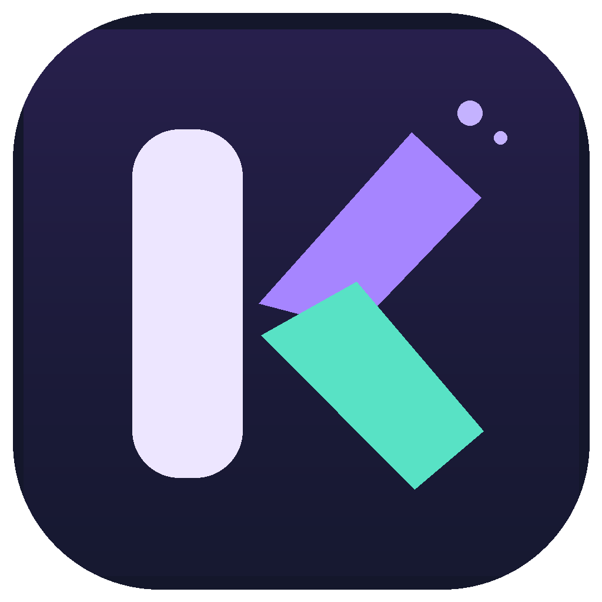

<div align="center">
  
  <h1>KeyMind 3.0</h1>
  <p><strong>Smart Arabic ↔ English keyboard-layout correction for Windows.</strong></p>
  <p>Type in the wrong keyboard layout? KeyMind can recognize the intended word and replace it while you type.</p>
  <p>
    
    
    
    
  </p>
  <p><a href="docs/README.ar.md">اقرأ بالعربية</a> · <a href="CONTRIBUTING.md">Contributing</a> · <a href="SECURITY.md">Security</a> · <a href="CHANGELOG.md">Changelog</a></p>
</div>

---

## What KeyMind does

KeyMind observes keyboard-layout input locally and attempts to repair words typed in the wrong Arabic or English layout, with options to control automatic correction and manually convert text. It runs in the Windows system tray.

| Feature | Description |
| --- | --- |
| Arabic ↔ English | Two-way conversion based on the physical keyboard layout |
| Automatic correction | Scores word candidates to avoid unnecessary changes |
| Manual controls | On-demand correction, undo, pause and restart listener |
| Dictionaries | Built-in word lists, custom vocabulary, and optional compact `.kmd` dictionaries |
| Diagnostics | Local listener status and counters to troubleshoot integration |
| Windows integration | Low-level keyboard listener plus simulated input for replacement |

**Example:** On an English keyboard layout, typing `lpl]` followed by Space may be corrected to `محمد` (with automatic correction enabled). Results depend on the surrounding application and the model's confidence.

> [!IMPORTANT]
> **Early-stage software.** Correction accuracy is not guaranteed. Some protected, elevated or specialized apps may block simulated keyboard input. The listener processes keystrokes system-wide; see [Privacy & security](#privacy--security) before use.

## Requirements

- **OS:** Windows 10/11 (desktop; Windows-only).
- **Recommended local build:** .NET Framework C# compiler (`csc.exe`, normally available with the .NET Framework developer tooling) for the included `*.cmd` scripts.
- **Alternative build:** .NET 10 SDK for the `KeyMind.csproj` project.
- **Python 3:** Optional, for reference tests and building large dictionaries.

## Quick start on Windows

1. Download or clone the complete source folder and keep `src/`, `assets/`, and `data/` together.
2. Close any already-running KeyMind instance from the notification area.
3. Run **`START-KEYMIND.cmd`**. It compiles the current source before launching the application. If the compiler is unavailable, read the error message from `Build-KeyMind.cmd` and install the required Windows developer tooling.
4. In Settings, verify **Engine Enabled** and **Auto correction** are on.
5. Test in **Notepad** before checking browsers or other editors. Use the **Live diagnostics** tab if correction does not occur.

**Important:** The repository intentionally does **not** version-control `KeyMind.exe`. Build it locally; the default launcher recompiles so an older binary does not silently run.

### Other build and test commands

```powershell
# Requires .NET 10 SDK:
dotnet build KeyMind.csproj -c Release

# Requires Python 3 (cross-platform checks):
python tests/verify_package.py
python tests/verify_background_listener.py
python tests/eval_accuracy.py

# Windows-only: C# engine smoke tests and reference parity vectors
.\TEST-ENGINE.cmd
```

To run the Windows legacy compiler explicitly, run `Build-KeyMind.cmd`. Do not run `REBUILD-KEYMIND.cmd` while a KeyMind instance is active.

## Dictionaries

Keep `data/` with the application. Personal dictionaries can be placed under `%LOCALAPPDATA%\KeyMind\dictionaries\`, and additional dictionaries can be generated using `tools/build_dictionary.py` (Python 3). See [DICTIONARIES.txt](DICTIONARIES.txt) for supported inputs and commands.

See [third-party attributions](THIRD_PARTY_NOTICES.md) before redistributing the bundled dictionaries.

## Privacy & security

- KeyMind's Windows hook observes keys system-wide to determine when to correct input.
- The reviewed source has no online telemetry or account sign-in path, but this is **not** a third-party security audit or guarantee against sensitive input exposure.
- The settings file is stored locally at `%LOCALAPPDATA%\KeyMind\settings.json`; application errors may be written to `%LOCALAPPDATA%\KeyMind\error.log`.
- Password fields are **not consistently detectable** in every browser or desktop app. **Pause or exit KeyMind when typing passwords, confidential information or financial data.**
- Do not publish diagnostic exports, custom dictionaries or logs without inspecting them.

See [SECURITY.md](SECURITY.md) for reporting and responsible disclosure.

## Project layout

```text
assets/               Branding and application icon
src/                  WinForms app, keyboard hook, layout and dictionary engine
data/                 Default Arabic/English dictionaries
tests/                C# smoke tests and Python reference checks
tools/                Dictionary construction utility
.github/              CI and community templates
KeyMind.csproj         Modern .NET Windows project
START-KEYMIND.cmd     Compile then launch on Windows
Build-KeyMind.cmd     Windows Framework compiler build
TEST-ENGINE.cmd       Windows engine tests
```

## Contributing and roadmap

Contributions should begin with a reproducible bug report or a focused proposal. See [CONTRIBUTING.md](CONTRIBUTING.md). Current priorities are application compatibility, preventing unwanted corrections, expanding Arabic vocabulary, improving accessibility and providing signed, reproducible releases.

## License status

The repository is being prepared **privately** for review. **No public open-source license is granted yet.** Ownership and redistribution permissions, including third-party dictionary notices, must be reviewed and a license selected before making this repository public. See [LICENSE](LICENSE).